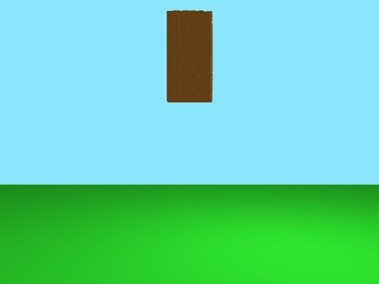
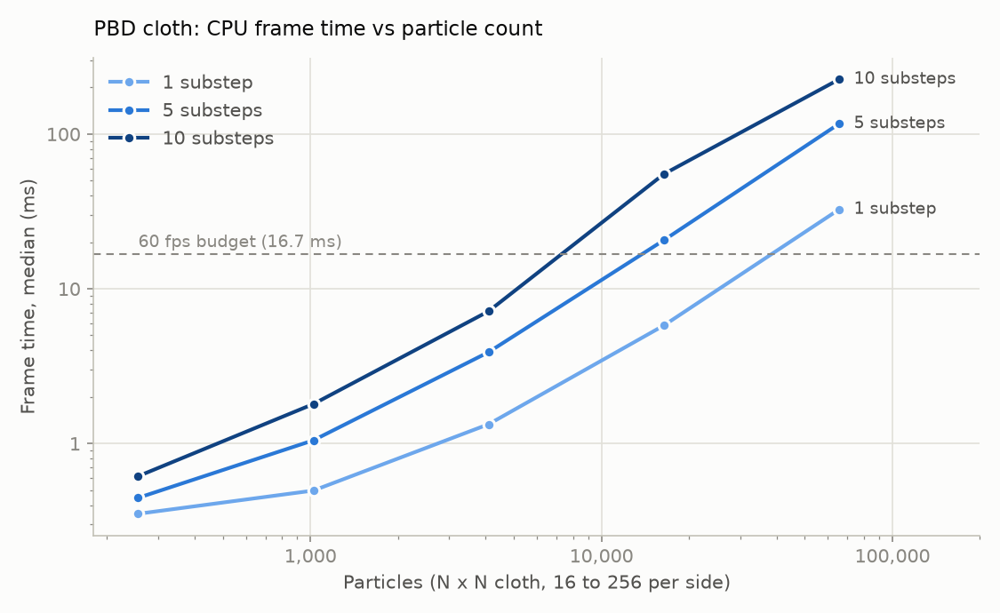
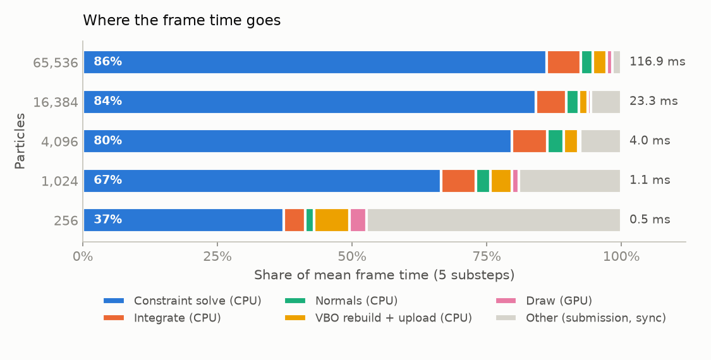

# PBDynamics

A cloth simulator built on Position Based Dynamics, written in C++ with OpenGL rendering. It comes with an instrumented benchmark mode that splits every frame into solver, upload and GPU draw time, and a sweep from 256 to 65,536 particles.



*The default scene: a cloth of 3,321 particles pinned at its top corners, with half of it given an initial push. 5 substeps, recorded with `--record`.*

## What is Position Based Dynamics?

Instead of computing forces and integrating accelerations, PBD first predicts where every particle would go under external forces like gravity. It then directly moves the predicted positions until the constraints, such as "these two particles stay this far apart", are satisfied. Velocities are then derived from how far each particle actually moved, which makes the method very stable and easy to control, and that's why games and real-time tools use it for cloth and soft bodies.

## What runs where

| Stage | Where | Code |
|---|---|---|
| Integrate: apply gravity, predict positions, ground clamp, update velocities | CPU, single thread | `Primitive::preUpdate` / `postUpdate` |
| Constraint solve: one Gauss–Seidel pass over all distance constraints (stretch along mesh edges and "bending" links) per substep | CPU, single thread | `Primitive::solve`, `Engine::solveStretchingConstraint` |
| Recompute vertex normals | CPU | `Primitive::computeNormals` |
| Rebuild the interleaved position + normal array and re-upload it (`glBufferData`) every frame | CPU → GPU | `Primitive::render` |
| Transform and Phong shading | GPU (vertex + fragment shader), 2 draw calls per frame | `shaders/` |

## Where the time goes

`--benchmark` sweeps an N×N cloth (N = 16…256) against 1, 5 and 10 substeps, using the same fixed 1/60 s step as the interactive mode. Each configuration gets 20 warm-up frames and then 200 timed frames, and the results go to [`bench/scaling.csv`](bench/scaling.csv).





**Hardware:** AMD Ryzen 9 5900HX (8C/16T, but the solver uses 1 thread), NVIDIA GeForce RTX 3050 Laptop GPU, driver 592.00, Windows 11, MSVC 14.44 Release build.

Mean ms per frame (p50/p95 are in the CSV):

| Particles | Constraints | Substeps | Frame (ms) | Solver (ms) | of which constraint solve (ms) | Normals + upload (ms) | GPU draw (ms) |
|---|---|---|---|---|---|---|---|
| 256 | 990 | 1 | 0.63 | 0.05 | 0.05 | 0.04 | 0.02 |
| 256 | 990 | 5 | 0.46 | 0.19 | 0.17 | 0.04 | 0.01 |
| 256 | 990 | 10 | 0.64 | 0.37 | 0.34 | 0.04 | 0.01 |
| 1,024 | 4,196 | 1 | 0.53 | 0.20 | 0.18 | 0.09 | 0.02 |
| 1,024 | 4,196 | 5 | 1.08 | 0.79 | 0.72 | 0.07 | 0.01 |
| 1,024 | 4,196 | 10 | 1.84 | 1.54 | 1.40 | 0.07 | 0.01 |
| 4,096 | 17,262 | 1 | 1.38 | 0.92 | 0.86 | 0.21 | 0.02 |
| 4,096 | 17,262 | 5 | 4.01 | 3.46 | 3.19 | 0.23 | 0.02 |
| 4,096 | 17,262 | 10 | 7.28 | 6.61 | 6.08 | 0.23 | 0.03 |
| 16,384 | 70,020 | 1 | 6.18 | 4.30 | 4.02 | 0.87 | 0.15 |
| 16,384 | 70,020 | 5 | 23.28 | 20.91 | 19.59 | 0.93 | 0.14 |
| 16,384 | 70,020 | 10 | 54.14 | 51.50 | 48.20 | 1.13 | 0.15 |
| 65,536 | 282,030 | 1 | 32.73 | 22.51 | 20.87 | 6.01 | 2.24 |
| 65,536 | 282,030 | 5 | 116.89 | 108.08 | 100.65 | 5.70 | 1.17 |
| 65,536 | 282,030 | 10 | 223.89 | 215.10 | 200.71 | 5.66 | 1.17 |

What the numbers show:

- **The CPU constraint solver is the bottleneck.** From 4,096 particles up, with 5 or more substeps, the constraint pass takes 80–90% of the frame. The GPU draw stays at 2.3 ms or less even at 65,536 particles and 130k triangles.
- **Real-time limit:** at the default 5 substeps the solver fits a 60 fps budget (16.7 ms) at 4,096 particles (4.0 ms per frame) but not at 16,384 (23.3 ms).
- **Cost per constraint grows with problem size.** At 5–10 substeps, one pass costs about 33–37 ns per constraint up to 4,096 particles, but 56–69 ns at 16,384 and 71–74 ns at 65,536, so frame time grows faster than particle count. This is consistent with the working set outgrowing the CPU caches. Constraints live in a `std::set`, a red-black tree where every step is a pointer chase to a separately allocated node, and at 65,536 particles it holds 282k nodes. I haven't profiled it yet.
- **At small sizes, fixed overhead dominates.** At 256 particles and 5 substeps, about half the frame is submission and synchronization, not simulation.
- **The upload is not free at scale.** At 65,536 particles, recomputing normals and re-uploading the full vertex buffer costs about 5.7–6.0 ms per frame on the CPU.

## Build and run

Dependencies: GLFW, GLEW, GLM and ImGui (vendored in `depends/`).

**Windows (MSVC + vcpkg)**, which produced the numbers above:

```bash
vcpkg install glfw3 glew glm --triplet x64-windows
cmake -S . -B build -G "Visual Studio 17 2022" -A x64 -DCMAKE_TOOLCHAIN_FILE=<vcpkg>/scripts/buildsystems/vcpkg.cmake
cmake --build build --config Release
./Release/PBDynamics                     # run from the repo root (shaders are loaded from ./shaders)
```

**Linux:** install GLFW, GLEW and GLM from your package manager, then `mkdir build && bash ./build.sh -c && ./PBDynamics`. This hasn't been re-tested since the benchmark changes.

**Benchmark, plots and GIF:**

```bash
./Release/PBDynamics --benchmark --frames 200 --csv bench/scaling.csv
python scripts/plot_scaling.py                     # -> docs/scaling.png, docs/breakdown.png
./Release/PBDynamics --record frames/ --frames 300  # saves every other frame of the default scene
python scripts/make_gif.py frames/ docs/cloth.gif
```

The interactive UI also shows the particle and constraint counts, the solver time, the normals + upload time, and the GPU draw time (from double-buffered `GL_TIME_ELAPSED` queries).

## Controls

- `Space`: start the simulation
- Mouse: look around; `W` `A` `S` `D`: move the camera
- `Q`: enable or disable camera movement
- `Ctrl`: quit
- ImGui panels: substeps, gravity, and cloth material and colors

## Next steps

- **Port the constraint solver to CUDA and measure the CPU vs GPU speedup.** Gauss–Seidel updates particles in place, so neighbouring constraints conflict when run in parallel. The plan is graph coloring, solving each color as one kernel launch, compared against a Jacobi-style solve with averaged corrections. Positions would stay on the GPU and be shared with OpenGL through CUDA–GL interop, which also removes the per-frame upload.
- **Make the CPU solver cache-friendly before comparing.** Store constraints in a flat array sorted by particle index instead of a `std::set`, split particle data into separate arrays (position, inverse mass), and multithread it with the same coloring. That gives a fair CPU baseline.
- **Fix bending constraint generation.** `Primitive::generateBendingConstraints` computes the "opposite" vertex as `indices[triangle + 3 - edge1 - edge2]`, where it needs `3 * triangle` plus the vertex slot opposite the shared edge. As a result the "bending" constraints link the wrong particles. The benchmark measures the engine as it is today.
- **Fix the orthographic projection.** Holding `P` flips the projection every frame, and the orthographic view is a fixed ±10 box that ignores the window's aspect ratio.
- **Fix window resizing.** `framebuffer_size_callback` assigns its parameters to themselves (`width = width`), so the aspect ratio never updates.
